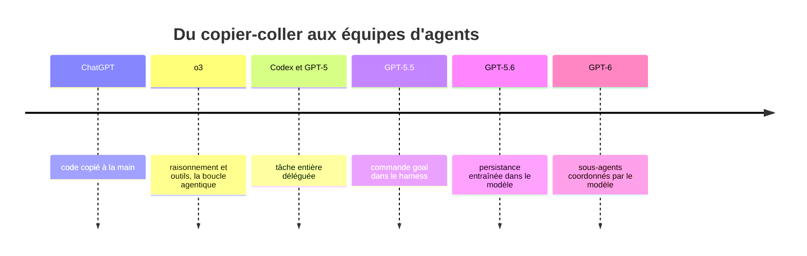

Lors du DevDay 2026, deux ingénieurs d'OpenAI retracent le chemin qui mène de ChatGPT écrivant du code à copier-coller jusqu'à des milliers d'agents qui collaborent. Le fil rouge : chaque fois que la communauté a bricolé une boucle autour du modèle pour le faire travailler plus longtemps, l'étape suivante a fait entrer ce comportement dans le modèle lui-même.

La session, [What Comes After Loops?](https://www.youtube.com/watch?v=nAubbmlhPfI), dure 24 minutes. Raj Pathak (Applied AI) raconte l'histoire et les choix de conception, Eric Provencher (Codex DX) donne les pratiques actuelles, puis Raj ouvre sur la suite.

## Un agent, c'est un modèle et son harness, entraînés ensemble

Raj part de son premier test de ChatGPT : écrire FizzBuzz, copier le code dans l'éditeur, le lancer. C'était impressionnant, mais c'est [lui qui faisait le va-et-vient](https://youtu.be/nAubbmlhPfI?t=78). Le changement vient quand le modèle [combine raisonnement et outils](https://youtu.be/nAubbmlhPfI?t=109), comme dans la démo d'o3 sur l'analyse d'image : c'est ce qu'OpenAI appelle la boucle agentique.

Avec Codex, l'idée est [de donner un ordinateur à l'agent](https://youtu.be/nAubbmlhPfI?t=140) et de l'entraîner à travailler dans son harness. Le harness gère les instructions, les outils, ce que le modèle voit, l'environnement d'exécution et le contexte transmis d'une étape à l'autre. Codex est open source et volontairement minimal, avec des outils généralistes comme le shell et le système de fichiers [(3:55)](https://youtu.be/nAubbmlhPfI?t=235). Au centre, la Responses API gère la boucle : définitions d'outils, exécution dans un bac à sable, ajout au contexte [(4:25)](https://youtu.be/nAubbmlhPfI?t=265).

La conception du harness influence l'entraînement, et inversement. L'exemple donné est la **compaction** : quand la fenêtre de contexte se remplit, l'historique est condensé. Codex l'appelle via la Responses API, et le modèle est [entraîné à reprendre le travail depuis un état compacté](https://youtu.be/nAubbmlhPfI?t=391). Résultat : il peut travailler sur plusieurs fenêtres de contexte d'affilée.

## La boucle externe est devenue une capacité du modèle

Restait un problème : les premiers modèles [ne savaient pas ce que « terminé » veut dire](https://youtu.be/nAubbmlhPfI?t=422) et s'arrêtaient trop tôt. La parade populaire était une boucle externe qui renvoie « continue » en boucle. Raj cite Peter Steinberger (créateur d'OpenClaw) pour l'idée et Geoffrey Huntley pour la *Ralph loop* : une boucle bash qui relance l'agent sur un fichier de prompt, avec un contexte neuf à chaque tour [(7:33)](https://youtu.be/nAubbmlhPfI?t=453). C'est ce qu'il appelle le *loop engineering*.

OpenAI a intégré le motif dans Codex avec la commande `/goal`, introduite avec GPT-5.5 : l'objectif est stocké [hors de la fenêtre de contexte](https://youtu.be/nAubbmlhPfI?t=515), donc la compaction ne peut pas l'effacer, et le harness vérifie si l'agent a fini ou s'il est réellement bloqué. Ce signal a servi à l'entraînement : avec GPT-5.6, [la persistance est entraînée dans le modèle](https://youtu.be/nAubbmlhPfI?t=546), qui vérifie son propre travail sans relance externe.

## Aujourd'hui : un seul agent d'abord, puis des sous-agents si le travail le justifie

Eric commence par une mise en garde : face à une longue tâche, la tentation est de monter [toute une équipe d'agents](https://youtu.be/nAubbmlhPfI?t=676), mais il vaut presque toujours mieux démarrer avec un seul agent, une tâche claire et un moyen de vérifier son travail. La série GPT-6 sait continuer, compacter et s'obstiner sans boucle externe.

Pour les gros chantiers (refonte complète, jeu entier), le mode Ultra de Codex [crée des copies de lui-même](https://youtu.be/nAubbmlhPfI?t=708). Mais chaque agent ajouté peut faire exploser la consommation de tokens sans rendre le travail plus rapide ou meilleur. Deux cas où cela se justifie : une tâche décomposable (relire cinq PR, un sous-agent chacune) ou une recherche large (une race condition difficile).

Il présente aussi le *effort scaling* : un skill nommé Coordinate fait travailler un modèle moyen sur l'essentiel, appelle un modèle plus fort pour les passages difficiles et délègue la routine à un modèle léger [(13:54)](https://youtu.be/nAubbmlhPfI?t=834). Il précise que ce n'est pas toujours moins cher ; le but est surtout d'éviter de se demander quel modèle choisir.

## Des motifs concrets pour piloter plusieurs agents

- **La paire** [(14:27)](https://youtu.be/nAubbmlhPfI?t=867) : deux agents aux frontières de communication explicites. Eric s'en est servi pour recréer dans Blender une vieille scène de jeu dont le moteur avait disparu, l'un capturant la scène, l'autre la reconstruisant.
- **Le gestionnaire de threads** [(15:30)](https://youtu.be/nAubbmlhPfI?t=930) : dans l'app ChatGPT, Codex peut lancer d'autres conversations et les piloter, par exemple une par PR à relire. On peut ouvrir chacune pour la corriger à la main.
- **Les chefs de département** [(17:01)](https://youtu.be/nAubbmlhPfI?t=1021) : un agent par domaine (art, design, programmation, tests) et un producteur qui coordonne. Pratique, mais pas économe en tokens.
- **Le journal de travail** [(18:03)](https://youtu.be/nAubbmlhPfI?t=1083) : après trois ou quatre compactions, l'agent peut perdre de vue le prompt initial. Eric lui demande de tenir un journal compact (objectif global, travaux en cours, lien avec les dernières consignes) sans en faire un journal intime de chaque test raté.

Son avertissement : chaque règle de collaboration ajoutée peut faire caler les agents dans des hiérarchies inventées. Il appelle ça [la taxe du middle management](https://youtu.be/nAubbmlhPfI?t=1052). Il termine en rappelant que [les bonnes pratiques ont une durée de vie](https://youtu.be/nAubbmlhPfI?t=1145).

## Demain : des équipes d'agents sur un même objectif

Raj clôt sur [Navier-Stokes](https://youtu.be/nAubbmlhPfI?t=1184), problème du millénaire. D'après lui, un modèle interne et Codex ont trouvé une solution avec 10 000 agents, 2,7 millions de messages et environ 130 milliards de tokens de sortie.

Le motif décrit s'appelle *agent teams* [(20:45)](https://youtu.be/nAubbmlhPfI?t=1245) :

1. Plusieurs équipes démarrent avec des versions différentes du problème, pour varier les approches.
2. Les équipes communiquent entre elles pour éviter le travail en double, ce qui coûterait très cher à cette échelle.
3. Quand de nouvelles pistes apparaissent, de nouvelles équipes sont créées. La répartition du travail change, [pas l'objectif](https://youtu.be/nAubbmlhPfI?t=1337).

Le résultat « Euler sans forçage » a ainsi réorienté toutes les équipes vers la solution. Raj ajoute que le modèle interne a résolu [plus de 100 problèmes de mathématiques](https://youtu.be/nAubbmlhPfI?t=1367) restés ouverts.

## Ce que j'ajouterais

- **Source unique, et c'est OpenAI qui parle de lui-même.** Les résultats sur Navier-Stokes et les 100 problèmes de maths sont des affirmations faites dans la présentation. Je n'ai pas cherché de confirmation indépendante.
- **Transcription automatique.** Les noms de modèles du passage sur l'effort (Sol, Astra, Luna) viennent des sous-titres et peuvent être mal retranscrits ; je les cite tels quels.
- **Mon avis.** L'enseignement le plus utile est que la boucle de contrôle que l'on écrit à la main aujourd'hui a vocation à être absorbée par le modèle. Il vaut mieux garder les orchestrations légères et réévaluer celles qui existent à chaque nouveau modèle.

## Takeaways

- Un agent performant, c'est un modèle et un harness conçus ensemble : la compaction et la persistance en sont les exemples donnés.
- Les boucles externes (Ralph loop, `/goal`) sont des étapes qui ont fini dans le modèle, selon OpenAI.
- Commencer avec un seul agent et un moyen de vérifier son travail. Ajouter des agents seulement si la tâche s'y prête, car ils coûtent des tokens.
- Pour garder le cap malgré les compactions, demander à l'agent un journal de travail compact.
- À grande échelle, l'enjeu est la diversité des pistes et la communication entre équipes, pas le nombre d'agents.
