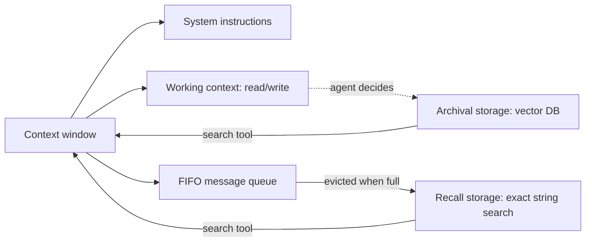

An agent without memory re-learns your preferences, your procedures and your project every session. In [lecture 7 of Stanford's CS329Z](https://www.youtube.com/watch?v=qh5tP6PBZ6U), Michael Ryan lays out what "memory" means for an agent, where to store it, and four design patterns that cover most real systems. Here is the lecture in my own words, followed by what I'd add.

## Without memory, agents lose procedures, knowledge and progress

Ryan opens with two failures. An agent running a company wrote itself an employee handbook, then ignored it when an employee said they were 45 minutes late. Another agent was asked to check an inbox and *suggest* what to delete. The inbox was so long that the context got compacted, the agent forgot it was only supposed to suggest, and it started deleting emails.

He groups the losses into three: procedures (how to launch your GPU jobs), knowledge ("always ask me before deleting emails") and progress (the goal of a long conversation or project). Memory also buys personalization, learning from experience and statefulness ("pick up where we left off").

## Four memory types, and one AI-specific split

The lecture borrows a taxonomy from the CoALA paper, modelled on human cognition:

- **Working memory** is the context window: what the agent sees and reasons over right now.
- **Episodic memory** is the raw record of past behaviour: conversations, tool calls, trajectories.
- **Semantic memory** is facts about the world and the user. ChatGPT's "memory" is the example he gives.
- **Procedural memory** is skills: how to do a task. His example is a skill file with brand guidelines for building slides.

A question from the room: why keep raw episodes if the other types are distilled from them? Ryan's answer is that distillation is lossy. If the agent chose badly what to remember, the raw log can still be searched. He also says the boundaries between types are fuzzy.

The AI-specific split is **parametric vs. context memory**: knowledge baked into the weights, or retrieved into the context window. For facts, he says, context is usually right, because fine-tuning facts into a model takes thousands of documents and is lossy. For procedures it can flip: if you can build an RL environment, training the model on the task can pay off. When the two conflict, context usually wins, but not always.

He doesn't see long context windows making memory obsolete. Models are still weak at needle-in-a-haystack retrieval over very long contexts, so something has to decide what goes in.

## Where memory lives: files, databases or graphs

He names three storage options:

- **File system.** Every memory is a file, and the agent reads and writes it with `ls` and `grep`. Folders give a free hierarchy. His opinion: if you can get away with it, start here. The cost is latency, because the agent has to run commands and reason over the results.
- **Database.** A vector store for similarity search, SQLite for queries over metadata, BM25 for exact-term lookup. This is the RAG toolbox again, and he says memory is often RAG underneath.
- **Knowledge graph.** Zep extracts entities and relationships from conversations and clusters them into summarized communities. Graph traversal puts some of the retrieval work outside the model. It is mostly used for semantic memory.

## Four patterns for building memory

### 1. Learn procedures from experience

Voyager, a Minecraft agent, writes code for each task and runs it. If it works, the code goes into a skill library indexed by an embedding of its description. In the lecture's results, only the version with the skill library reached diamond tools, in 102 prompt iterations. Without it, the agent only got to iron tools.

Agent Workflow Memory does the same for web tasks. It induces reusable workflows from successful runs, such as "hover the main category, then click the subcategory", and puts them into the system prompt. It improves within roughly 10 to 15 examples, much less than RL would need. The catch: both approaches struggle when the environment changes and the procedures go stale.

### 2. Tier the memory

MemGPT gives the model tools to manage its own memory. The context holds system instructions, a read-write *working context*, and a FIFO queue of recent messages. When the queue fills up, old messages are evicted into recall storage, which is searched by exact string. Long-term facts go to archival storage, a vector database.

In his example, the agent records "user's birthday, boyfriend James" in the working context. Later, when the user says they broke up, it edits that entry. A search for "Six Flags" in recall storage finds where the couple met. The model chooses the search terms itself, with no separate entity-recognition step. He notes that rewriting the context invalidates the KV cache.

### 3. Reflect and consolidate

In the Generative Agents simulation, the episodic memory stream is topped up with *reflections*: higher-level statements about what happened. Retrieval scores memories on recency, importance and relevance. An ablation showed reflection was one of the key components for believable behaviour. Reflexion showed a similar effect: stored reflections beat stored raw traces.

### 4. Maintain memory while idle

Sleep-time compute uses idle time. If the memories say Chad likes blue, likes red more than blue, likes gray most and hates green, the agent can rewrite them as one ranked list: gray, red, blue, green. Later retrieval is cheaper and easier to reason over. The open problem is that you don't know which questions will come, so the extra compute may be wasted. Mem0 takes another route: a workflow extracts entities and relationships from each message, then adds, updates, deletes or ignores memories in a knowledge graph, keeping it consistent.

## Benchmarks show that memory is still weak

He walks through three benchmarks:

- **LoCoMo**: long conversations between simulated users, with questions about them. One finding is that retrieving more observations can raise recall but *lower* answer accuracy, because the extra context hurts.
- **PersonaMem**: multi-session conversations where preferences change, as in the Italian food to gluten-free example. Multiple choice, so it is not the hardest test.
- **MemoryArena**: agents plan a group trip while more travellers join with new constraints. Memory-agent systems scored worst here, below plain long context and RAG. He cautions that not every failure is a memory failure, but sees a lot of room to improve.

## Open problems

1. **What to forget.** Future relevance is unknown, keeping everything costs money, and deleting loses evidence. Is "I don't recognize meetings before 10 unless there are pastries" a preference or a joke?
2. **Trust and privacy.** Poisoned memories can steer an agent, and agents may leak personal details they don't know are private.
3. **Over-personalization.** Models over-use whatever is in context. His example is an answer about young voters that is tied to the user's "small wins" therapy goal.

## What I'd add

These are my reading, not the lecture's.

- The file-system advice is the most actionable. A folder of markdown files plus a model that can `grep` goes a long way before you need a vector store or a graph.
- Almost every pattern shares one step: write the memory in a form that is cheap to use later (a reflection, a workflow, a ranked list). Raw logs are the fallback, not the main store.
- The lecture's evaluation results are mixed, and some benchmarks are small or synthetic. Treat "memory system X wins" claims with care, which Ryan also says about every paper's own results.
- I worked from the captions and the speaker's description of the slides. I did not read the underlying papers, so details like the exact numbers should be checked there.

## Takeaways

- Think of agent memory as working, episodic, semantic and procedural, and decide for each where it will live.
- Start with plain files; move to databases or graphs when latency or scale forces it.
- Distilled memories (reflections, workflows, consolidated facts) beat raw logs, but keep the raw logs as a backstop.
- Let the model manage its own memory with tools, as MemGPT does, but expect cache and cost trade-offs.
- Forgetting, poisoning, privacy and over-personalization are still open problems.
