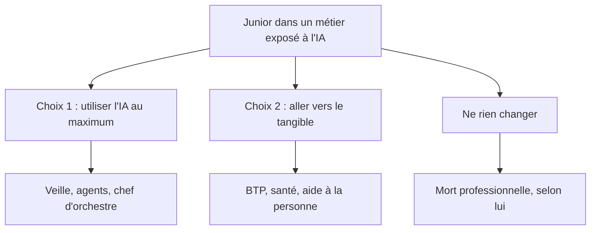

Tom, l'auteur de la chaîne Carnet de Tom, a un double master en graphisme et UX/UI, a cherché du travail pendant six mois, puis a repris un BTS électrotechnique en alternance. Ses deux vidéos racontent ce parcours, puis en tirent une analyse du marché de l'emploi des jeunes face à l'IA. C'est un témoignage, pas une étude, mais il décrit avec précision un mécanisme que beaucoup de juniors rencontrent en ce moment.

## Un double master qui n'ouvre aucune porte

Dans [« J'ai fait 5 ans d'études pour RIEN »](https://www.youtube.com/watch?v=dQFjuqsF9Lk), Tom retrace son parcours : un DN MADE en graphisme, des petits boulots faute d'emploi, puis un master en école privée à Lyon, en alternance comme designer UX/UI ([1:17](https://youtu.be/dQFjuqsF9Lk?t=77)). Diplômé en juin 2025, il candidate depuis janvier, refait CV et portfolio des dizaines de fois, et n'obtient rien.

Il découvre aussi que son « double master » est en partie creux : un diplôme d'école, qu'il juge sans valeur hors de l'école, et un titre RNCP, le seul vraiment reconnu ([6:42](https://youtu.be/dQFjuqsF9Lk?t=402)). L'école elle-même le déçoit : des cours rédigés par l'IA, auxquels les étudiants répondent avec l'IA, et des cours de « prompt manager » ajoutés en cours de route, contre lesquels la promo a fait une pétition ([4:39](https://youtu.be/dQFjuqsF9Lk?t=279)). Il résume : on apprenait à faire faire notre métier par autre chose.

## Un marché du graphisme saturé

Les chiffres qu'il donne viennent de son expérience, pas d'une enquête, mais ils sont parlants. Des offres de « graphiste exécutant » qui demandent aussi réseaux sociaux, vidéo et motion design, pour 1 600 € net à Lyon. Des seniors de plus de dix ans d'expérience qui postulent aux mêmes postes. Et, selon un recruteur, 250 candidatures pour un poste de déclinaison de catalogue en province ([8:08](https://youtu.be/dQFjuqsF9Lk?t=488)).

Il décrit aussi la rotation des alternants : on en prend un pour un ou deux ans, puis le suivant, plutôt que d'embaucher. Résultat, selon lui, beaucoup de diplômés deviennent freelances précaires avec un emploi alimentaire à côté ([10:47](https://youtu.be/dQFjuqsF9Lk?t=647)). Pire, le master lui ferme les emplois hors de son domaine : en grande surface, il est « surqualifié », et il faut retirer le diplôme du CV ([14:44](https://youtu.be/dQFjuqsF9Lk?t=884)).

## L'IA prend les tâches qui servaient à former les juniors

La seconde vidéo, [« N'apprends PAS ces métiers en 2026 »](https://www.youtube.com/watch?v=sYP4m3AvcjA), élargit le propos. Son argument central : un junior est embauché pour des tâches répétitives et chronophages, le temps d'être formé, et ce sont justement les tâches où l'IA est la plus performante ([0:29](https://youtu.be/sYP4m3AvcjA?t=29)). Le junior n'est donc plus rentable.

Il en tire un risque à long terme, le « pont brisé » ([1:58](https://youtu.be/sYP4m3AvcjA?t=118)). Le senior corrige ce que l'IA produit (« l'IA te fournit la pierre, tu viens la tailler »), le junior n'apprend plus en faisant, et on lui demande quand même de l'expérience. Dans dix ou vingt ans, quand les seniors partiront, la relève manquera. Il compare avec le nucléaire français, où il a fallu reformer des compétences qu'on avait laissé se perdre.

Il ajoute une critique du système éducatif : le discours « la réussite, c'est un bac + 5 » produit trop de diplômés généralistes, ce qui fait baisser la valeur du diplôme ([5:37](https://youtu.be/sYP4m3AvcjA?t=337)). Ses pistes : plus de sélection à l'entrée, plus d'apprentissage technique sur le modèle suisse, et une sorte de « Nutri-score » obligatoire qui noterait l'employabilité de chaque formation, en particulier dans les écoles privées à 10 000 € l'année ([9:41](https://youtu.be/sYP4m3AvcjA?t=581)).

## Deux stratégies, et un piège

Pour Tom, il reste deux choix de carrière ([15:28](https://youtu.be/sYP4m3AvcjA?t=928)) :

Le premier, c'est de maîtriser l'IA à fond : veille quotidienne, tester chaque nouvel outil, créer des agents, et changer d'outil quand un concurrent devient meilleur. Il compare avec le scribe qui devient imprimeur. Le second, qu'il a choisi, c'est de « fuir vers le tangible » : métiers manuels, santé, aide à la personne, où la valeur passe par le geste et le contact ([16:56](https://youtu.be/sYP4m3AvcjA?t=1016)).

Il nuance ce second choix : le BTP use physiquement, et il vise un poste de technicien en bureau d'études plutôt qu'électricien de chantier. Surtout, se reconvertir par dépit ne suffit pas, il faut « une petite flamme ». Le vrai piège, pour lui, c'est de ne rien changer par ego de bac + 5 et de continuer à candidater dans le vide ([18:28](https://youtu.be/sYP4m3AvcjA?t=1108)).

Sa propre reconversion lui donne raison sur un point : il a été mieux reçu en entretien pour une alternance en BTS que dans son domaine d'origine, et il pense que c'est son savoir-être qui a fait la différence ([20:23](https://youtu.be/dQFjuqsF9Lk?t=1223)). Il ne voit pas ce passage du bac + 5 au bac + 2 comme une régression, mais comme « une correction ».

## Ce que j'ajouterais

Ces vidéos restent un témoignage. Les chiffres (250 candidatures, 1 600 € net, trois quarts de freelances) sont des observations personnelles, et les listes de métiers « à éviter » ou « protégés » sont des avis, pas des projections chiffrées. La crise du graphisme junior a aussi d'autres causes que l'IA, que Tom cite d'ailleurs : l'après-Covid, le nombre de diplômés, le coût d'un CDI.

L'argument du pont brisé me paraît le plus solide. Ce blog est en partie écrit avec un agent, et je le vois de près : l'IA fait très bien les tâches d'exécution, mais pour relire ce qu'elle produit, il faut l'expérience qu'on acquérait justement en faisant ces tâches. Ses deux stratégies ne s'excluent pas non plus : un technicien en bureau d'études utilisera lui aussi des outils d'IA. La question utile n'est peut-être pas « quel métier l'IA épargne », mais « où mon jugement reste nécessaire ».

## À retenir

- Un bac + 5 généraliste ne garantit plus ni emploi ni salaire, surtout en communication, marketing et graphisme.
- L'IA absorbe les tâches répétitives qui servaient à former les juniors, d'où un risque de pénurie de seniors dans dix à vingt ans.
- Avant de s'engager, il faut vérifier les débouchés réels d'une formation, pas seulement l'envie qu'on en a.
- Les deux voies proposées sont de maîtriser l'IA, ou d'aller vers des métiers tangibles. Rester immobile est le pire choix.
- Une reconversion vers un métier technique peut réutiliser l'organisation, la gestion de projet et le savoir-être.
