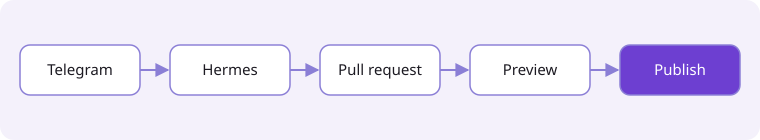
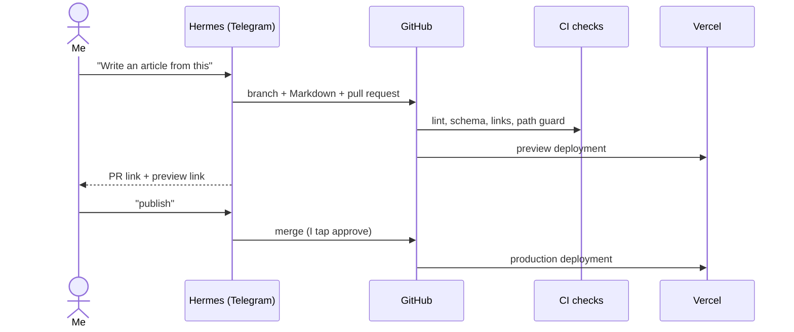

This blog is written in conversation. I talk with **Hermes**, my assistant on Telegram, about a topic or a
YouTube video. When something is worth keeping, Hermes turns it into an article, and I publish it without
leaving the chat.

## The pipeline

## Why Markdown in git

- **Reviewable**: every article is a pull request with a preview link, so nothing goes live unseen.
- **Safe**: articles are plain Markdown. No MDX, no raw HTML, so an article can't run code.
- **Durable**: no database to pause or migrate. The site is static and served from Vercel's CDN.

> [!NOTE]
> Hermes can only touch `apps/blog/content/` and can't change the code or the checks that guard it.
