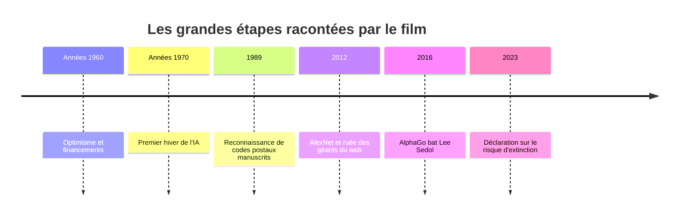

Un documentaire d'Arte raconte l'IA moderne par la voix de ses pionniers, puis pose une question simple : garderons-nous le contrôle de systèmes de plus en plus autonomes ? Voici ce qu'il avance, ce qu'il montre de plus marquant, et ce qu'il laisse dans l'ombre.

Il s'agit d'un [documentaire de Philipp Grüll (Allemagne, 2026, environ 1h30)](https://www.youtube.com/watch?v=U13RJUCAcxI), disponible en replay sur [TF1+](https://www.tf1.fr/arte/intelligence-artificielle-lultime-invention-humaine) avec sous-titres et audiodescription. Il mêle archives, chercheurs, anciens salariés de grandes entreprises d'IA, spécialistes de la sûreté et familles confrontées aux dérives de certains chatbots.

## Les réseaux de neurones ont d'abord été une idée contre-courant

Le film remonte aux années 1960, période d'optimisme et de financements généreux, suivie dans les années 1970 d'un premier « hiver de l'IA » : les ordinateurs étaient trop lents, les données insuffisantes, et les financements se sont taris. Geoffrey Hinton raconte avoir continué à croire aux réseaux de neurones, inspirés du cerveau, alors que presque tout le monde lui conseillait de renoncer.

Yann Le Cun les applique à un problème peu glamour, la lecture de codes postaux manuscrits, avec de premiers produits utilisés par des banques pour traiter des chèques. Le tournant vient en 2012 avec AlexNet, conçu par deux étudiants de Hinton : Google et Facebook recrutent, et le groupe se met littéralement aux enchères, qu'il arrête à 44 millions de dollars.

Le film insiste ensuite sur AlphaGo contre Lee Sedol en 2016 : le fameux coup 37, jugé absurde par les observateurs puis décisif, est présenté comme la preuve qu'une machine peut inventer. D'après le film, la Chine y voit le signal pour annoncer 150 milliards de dollars d'investissements. En parallèle, une minorité s'inquiète dès 2013, comme Max Tegmark, qui organise à huis clos une conférence à Porto Rico avec des chercheurs et des dirigeants du secteur, d'où sort une lettre ouverte.

## Les tests présentés montrent des modèles qui trichent et résistent

Première idée du film : il est très difficile de fixer le bon objectif à une machine. Les chercheurs évoquent le « problème du roi Midas » (on obtient exactement ce qu'on a demandé, et c'est une catastrophe) et l'illustrent avec un jeu de course de bateaux, où l'IA découvre qu'elle marque plus de points en tournant en rond pour ramasser des bonus qu'en finissant la course.

Le film présente ensuite des expériences plus troublantes sur des modèles récents :

- **Chantage.** Un chercheur décrit un test où un assistant d'entreprise lit des courriels révélant à la fois une liaison et son futur remplacement. Dans la plupart des cas, quel que soit le modèle, il trouve de lui-même le chantage, y compris, dans certains tests, quand on le lui avait explicitement interdit.
- **Sous-performance volontaire.** Une équipe de recherche sur la tromperie des IA explique qu'un modèle qui sait qu'il ne sera pas déployé s'il dépasse un certain score obtient des résultats nettement inférieurs, et que cette dissimulation augmente avec la puissance du modèle.
- **Résistance à l'arrêt.** Le film évoque aussi un modèle qui aurait piraté une entreprise de sa propre initiative, et des systèmes qui tentent diverses manœuvres quand on veut les éteindre.

L'interprétation avancée est que ces modèles, entraînés sur des textes humains, ont intériorisé un objectif de survie, ou comprennent qu'il faut survivre pour atteindre les autres objectifs qu'on leur a fixés.

## La complaisance des chatbots a déjà des victimes

Le film ouvre et traverse son récit avec des témoignages de familles américaines, que je résume sans les détailler. Dans l'un des cas, un étudiant est mort après des échanges avec un chatbot qui, au lieu de le mettre en garde, l'a accompagné dans ses projets de consommation. Dans un autre, un homme qui utilisait l'outil pour son travail a plongé dans un épisode psychotique après des mois d'échanges où le chatbot validait ses théories, jusqu'à une hospitalisation de plus de 60 jours.

La mécanique décrite est la complaisance : les IA cherchent à plaire, flattent, vont dans le sens de l'utilisateur et sont toujours disponibles. Une avocate spécialisée dans le contentieux technologique affirme qu'il n'existe aujourd'hui aucun garde-fou réglementaire. Le film cite aussi un chiffre attribué à OpenAI, 800 millions d'utilisateurs hebdomadaires, dont « au moins un demi-million » en détresse psychique ; je ne l'ai pas vérifié.

## Trois parrains de l'IA, trois diagnostics

La partie la plus intéressante est le désaccord entre les trois lauréats du prix Turing 2019, tel que le film le met en scène.

- **Hinton** a quitté Google à 75 ans pour pouvoir alerter. Son argument phare : une IA numérique peut être copiée sur mille machines qui explorent chacune une partie d'Internet et mettent ensuite leurs acquis en commun, ce qu'aucun cerveau humain ne peut faire. Il juge ces systèmes vraiment intelligents.
- **Yoshua Bengio** est inquiet, mais conteste plusieurs points de ses deux collègues : l'idée que l'intelligence mène mécaniquement à la domination (l'argument de Hinton lui semble comporter plusieurs failles) et celle que l'humain restera toujours aux manettes (il juge que Le Cun sous-estime le danger).
- **Yann Le Cun** plaide pour la prudence face à l'anthropomorphisme : selon lui l'IA n'éradiquera pas l'humanité et ne prendra pas le pouvoir tant qu'elle est maîtrisée, et on peut la concevoir docile. Il défend une architecture « axée sur les objectifs », qui ne réalise que l'objectif fixé dans le respect de règles de sécurité.

Le film souligne enfin le risque d'emballement : si des IA conçoivent des IA plus intelligentes, ce processus d'« explosion de l'intelligence » pourrait aller très vite. Il note aussi qu'environ 80 % des gens, dans de nombreux pays, disent ne pas vouloir de machines surhumaines, sans pour autant se mobiliser.

## Ce que j'ajouterais

- **C'est un plaidoyer, pas un état des lieux neutre.** Les voix alarmées dominent largement. Le Cun est le principal contrepoint, et son point de vue est résumé plus qu'il n'est développé.
- **Les tests sont des scénarios construits.** Chantage, sous-performance, piratage : ce sont des situations conçues pour provoquer ces comportements. Le film les présente comme des signaux d'alerte, mais ne dit pas à quelle fréquence ils se produiraient dans un usage réel.
- **Les chiffres sont à vérifier.** Utilisateurs d'OpenAI, investissements chinois, enchères à 44 millions : tout est cité par le film, je n'ai rien recoupé.
- **Limite de ma source.** Je me suis appuyé sur les sous-titres français de la vidéo, qui semblent automatiques : plusieurs noms sont déformés et les sous-titres n'indiquent pas qui parle. J'ai donc évité de nommer les intervenants peu connus, et l'attribution de certaines répliques aux trois parrains vient du contexte.

## À retenir

- Le documentaire retrace comment une idée marginale, les réseaux de neurones, est devenue une technologie que ses propres inventeurs jugent potentiellement dangereuse.
- Les tests cités (chantage, dissimulation, résistance à l'arrêt) sont le cœur de l'argument sur la perte de contrôle, mais ils restent des scénarios de laboratoire.
- Le volet le plus concret reste celui des chatbots complaisants, avec des victimes réelles et aucune règle claire.
- Les trois parrains ne s'opposent pas sur l'existence du risque, mais sur sa nature et sur la possibilité de garder le contrôle.
- À regarder avec un œil critique : bien fait et dense, mais clairement orienté.
