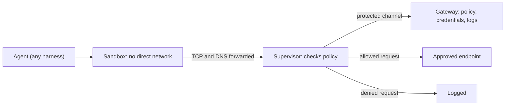
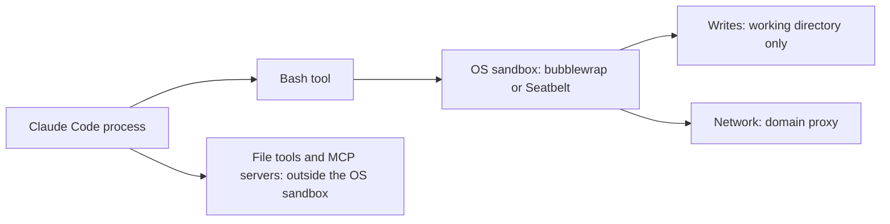

Both systems try to cap what an AI agent can do without a human approving each step. They differ in who operates the boundary and where the policy lives. This article compares NVIDIA's [OpenShell](https://docs.nvidia.com/openshell/about/overview), a runtime you operate yourself, with Anthropic's containment options: the code execution container in the API, the Claude Code sandbox, and cloud sessions.

## Why containment instead of approval prompts

Anthropic's own argument starts with approval fatigue. In [its containment write-up](https://www.anthropic.com/research/how-we-contain-claude), telemetry showed users approved roughly 93% of Claude Code permission prompts, so each approval told the user less. The alternative is to limit what the agent can reach through sandboxes, virtual machines and egress controls.

Both products take that route. OpenShell describes itself as kernel-level isolation plus declarative YAML policy, so teams can run agents without giving them unrestricted access to files, credentials or networks [(overview)](https://docs.nvidia.com/openshell/about/overview).

## OpenShell's moving parts

The [architecture page](https://docs.nvidia.com/openshell/about/architecture) splits a sandbox into four pieces:

- **Sandbox**: holds the agent's processes and forwards TCP and DNS traffic to the supervisor.
- **Outer network fence**: denies all egress from the workload except its protected connection to the supervisor. Each runtime builds this with its own native tools.
- **Supervisor**: runs on the trusted side. It checks requests against policy and connects back to the gateway.
- **Gateway**: the control plane. It manages sandbox lifecycle and delivers policy, settings and credentials.

The [NVIDIA product page](https://www.nvidia.com/en-us/ai/openshell/) says the sandbox filters system calls in the kernel and sends requests to the supervisor through one channel for approval. Credentials are the notable part. The [overview](https://docs.nvidia.com/openshell/about/overview) says the agent sees opaque placeholders, and real values resolve only at endpoints the provider profile authorizes. Filesystem limits use Landlock, and process limits use seccomp and an unprivileged identity.

Policy changes come in two speeds. Network rules can be changed at runtime. Filesystem and process settings are locked when the sandbox is created, according to the [overview's protection table](https://docs.nvidia.com/openshell/about/overview). The product page adds that a policy prover uses formal verification to check whether a proposed network rule adds risky access.

## Anthropic's three containment options

Anthropic runs three different setups, and they answer different questions.

- **Code execution in the API**: a server-side sandbox container for Bash and file operations. The [code execution docs](https://platform.claude.com/docs/en/agents-and-tools/tool-use/code-execution-tool) say the container has no internet access, so Claude can only use preinstalled libraries. A container ID can be passed back to reuse the same files across requests.
- **Claude Code sandbox**: the built-in Bash sandbox uses bubblewrap on Linux and Seatbelt on macOS. Writes are limited to the workspace, and network traffic goes through a domain-allowlisting proxy. Anthropic reported an 84% drop in permission prompts from this in internal use [(sandboxing post)](https://www.anthropic.com/research/claude-code-sandboxing).
- **Cloud sessions**: Claude Code runs in an Anthropic-managed VM behind a network proxy with a default allowlist. A separate proxy holds the GitHub token outside the sandbox [(sandbox environments)](https://code.claude.com/docs/en/sandbox-environments).

The last line is the important one. The built-in Bash sandbox does not cover Claude Code's file tools, MCP servers or hooks. [Anthropic's sandbox docs](https://code.claude.com/docs/en/sandbox-environments) recommend running the whole process inside the sandbox runtime, a dev container or a VM when those need to be contained too.

## Side by side

- **Who operates the boundary**: you run OpenShell, which includes a gateway. Anthropic runs the code execution container and cloud sessions. The local Claude Code sandbox runs on your machine.
- **Agent scope**: OpenShell's overview lists Claude Code, OpenCode, Codex and GitHub Copilot CLI as agents it can run. Anthropic's pages I read describe these sandboxes only for Claude.
- **Policy**: OpenShell uses declarative YAML with hot-reloadable network rules. Anthropic's Claude Code sandbox uses settings for domains and write paths, and organizations can enforce them through managed settings.
- **Maturity**: OpenShell is at version 0.1.x. The docs I read label the latest version as v0.1.4 on one page and v0.1.6 on another, so check the version you deploy. Anthropic's sandbox runtime is a beta research preview.

## Takeaways

- Choose OpenShell when you need one policy and audit trail across several agents and models. Choose Anthropic's options when you already run Claude and want the least setup.
- OpenShell's policy-as-code and audit log are its main differences from Anthropic's options, according to the vendor's own pages.
- Both products rely on mature kernel primitives. Anthropic's containment write-up says the standard primitives held up while its own custom components exposed flaws, so review any glue code you add.
- Claude Code's docs say to run `--dangerously-skip-permissions` only inside a container, a VM or the sandbox runtime.

## What I did not verify

I did not run either product. The points above come from vendor documentation and Anthropic's research posts. I found no independent security audit or benchmark for OpenShell. The no-internet claim for the code execution container came from the search result summary of the docs page, not from reading the full page. OpenShell is a 0.1.x release, so its docs may change quickly.
