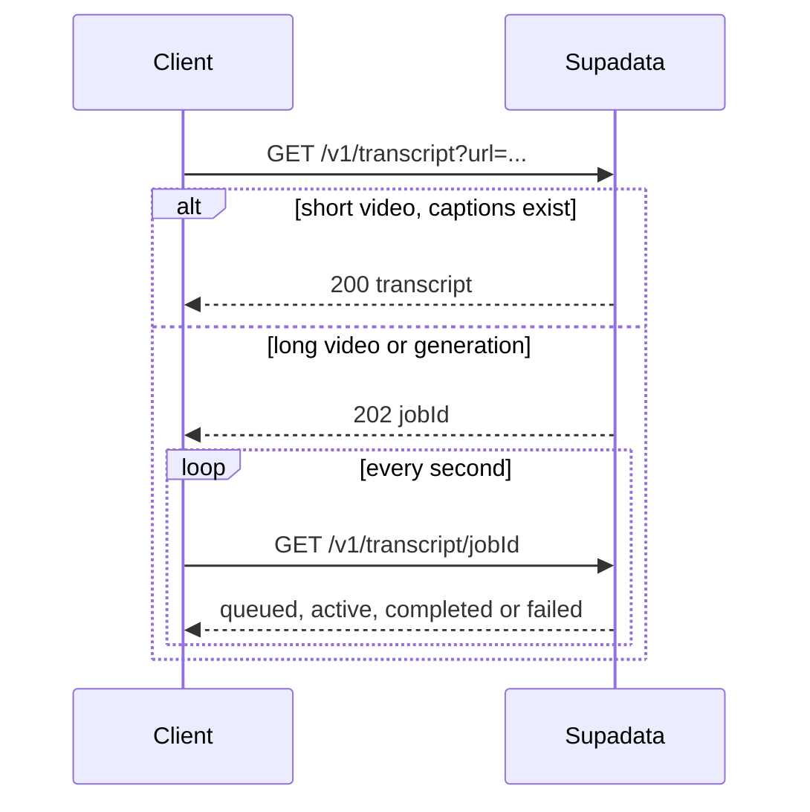

Supadata is a hosted API that turns videos and web pages into text an LLM or a script can use: transcripts, metadata, Markdown and structured JSON. This tutorial walks through the setup, the three calls I find most useful, and the one detail that trips people up: some requests answer later, through a job you poll.

> [!NOTE]
> Supadata offers API credits to people who publish a tutorial about it, and this is one. If you sign up through [my referral link](https://supadata.ai/r/SBW6NDFK), I get credits too. Everything below comes from their public docs, linked at each claim.

## What the API covers

The [documentation](https://docs.supadata.ai/) lists five services: video transcripts, media metadata, structured data extraction, a web reader and YouTube metadata. Transcripts work for YouTube, TikTok, Instagram, X and Facebook, plus public audio or video files (MP4, WEBM, MP3, WAV and a few others, up to 750 MB and 12 hours) according to the [transcript guide](https://docs.supadata.ai/get-transcript).

Billing is in credits. As listed on the [pricing page](https://supadata.ai/pricing) (November 2026), the free plan gives 100 credits a month at 1 request per second, without a credit card. A transcript that already exists on the platform costs 1 credit; one Supadata has to generate with speech-to-text costs 2 credits per minute of audio. Scraping a URL costs 1 credit and an AI extraction 5 credits per minute of video. Credits don't roll over.

## Setup takes two minutes

1. Create an account ([sign up here](https://supadata.ai/r/SBW6NDFK)). The API key is generated during onboarding and stays visible in the dashboard.
2. Every request goes to `https://api.supadata.ai/v1` with the key in an `x-api-key` header ([docs](https://docs.supadata.ai/)).
3. Install an SDK if you prefer one to raw HTTP: `@supadata/js` for [Node](https://docs.supadata.ai/integrations/node), `supadata` for [Python](https://docs.supadata.ai/integrations/python).

```bash
npm install @supadata/js   # or: pip install supadata
export SUPADATA_API_KEY="..."  # keep it out of your code and your repo
```

Check that the key works with a plain request:

```bash
curl 'https://api.supadata.ai/v1/transcript?url=https://youtu.be/dQw4w9WgXcQ&text=true' \
  -H "x-api-key: $SUPADATA_API_KEY"
```

## Transcripts: handle the 202 from day one

`GET /v1/transcript` takes a `url`, an optional `lang` (ISO 639-1), `text=true` for plain text instead of timestamped chunks, and a `mode`. The [transcript guide](https://docs.supadata.ai/get-transcript) defines the modes: `native` only returns captions that already exist, `generate` always transcribes the audio, and `auto` (the default) tries native first and falls back to generation.

The response isn't always the transcript. Videos longer than 20 minutes, and generated transcripts that run long, come back as HTTP 202 with a `jobId`. You then poll `GET /v1/transcript/{jobId}` until the status is `completed` or `failed`. The docs recommend polling every second, and say polling is free and results expire an hour after completion.



Here is a small TypeScript helper that hides that difference. It uses `fetch` only, so it runs in Node 18+, Deno or a Next.js route handler:

```ts
const API = "https://api.supadata.ai/v1";
const headers = { "x-api-key": process.env.SUPADATA_API_KEY! };

export async function transcript(url: string, lang = "en"): Promise<string> {
  const query = new URLSearchParams({ url, lang, text: "true", mode: "auto" });
  const first = await fetch(`${API}/transcript?${query}`, { headers });
  if (!first.ok) throw new Error(`Supadata ${first.status}: ${await first.text()}`);

  let body = await first.json();
  if (first.status === 202) {
    const { jobId } = body;
    do {
      await new Promise((r) => setTimeout(r, 1000));
      body = await (await fetch(`${API}/transcript/${jobId}`, { headers })).json();
    } while (body.status === "queued" || body.status === "active");
    if (body.status === "failed") throw new Error(JSON.stringify(body.error));
  }
  return body.content;
}
```

A 200 with an empty `content` means no speech was detected, and it is still charged. The SDKs wrap the same flow: in Python, `supadata.transcript(url=..., text=True)` returns either the transcript or an object with a `job_id`, which you pass to `supadata.transcript.get_job_status()` ([Python SDK](https://docs.supadata.ai/integrations/python)).

## Web pages become Markdown

`GET /v1/web/scrape?url=...` returns the page's main content as Markdown, along with its title, description and the links it contains ([scrape reference](https://docs.supadata.ai/api-reference/endpoint/web/scrape)). Add `noLinks=true` to drop the links from the Markdown. Two siblings complete it: `/web/map` lists a site's URLs, and `/web/crawl` scrapes up to 5,000 pages as a job (crawl is reserved for Pro plans and above).

```python
from supadata import Supadata

supadata = Supadata(api_key="YOUR_API_KEY")
page = supadata.web.scrape("https://example.com")
print(page.content)  # Markdown, ready to feed a model
```

## Structured JSON from a video

`POST /v1/extract` is the most interesting endpoint for automation. You send a video URL with a natural-language `prompt`, a JSON Schema, or both, and Supadata returns data shaped to it ([extract reference](https://docs.supadata.ai/api-reference/endpoint/extract/extract)). It always answers with a job, polled at `GET /v1/extract/{jobId}` like transcripts; the result is in `data`.

```bash
curl -X POST 'https://api.supadata.ai/v1/extract' \
  -H "x-api-key: $SUPADATA_API_KEY" \
  -H 'Content-Type: application/json' \
  -d '{
    "url": "https://www.youtube.com/watch?v=dQw4w9WgXcQ",
    "schema": {
      "type": "object",
      "properties": {
        "topics": { "type": "array", "items": { "type": "string" } },
        "summary": { "type": "string" }
      }
    }
  }'
```

If you send only a `prompt`, the job result also includes the schema Supadata inferred, which you can save and reuse so later calls return the same shape.

## Errors and agent access

Errors come back as JSON with an `error` code, a `message` and a `documentationUrl` ([error list](https://docs.supadata.ai/errors/list)). The ones to handle are `limit-exceeded` (429, back off and retry), `upgrade-required` (402, out of credits or plan) and `transcript-unavailable` (206, which still costs 1 credit).

For AI agents there is a hosted [MCP server](https://docs.supadata.ai/integrations/mcp) exposing the same features as tools (`supadata_transcript`, `supadata_scrape`, `supadata_extract` and their status checks). In Claude Code it's one command:

```bash
claude mcp add --transport http supadata https://api.supadata.ai/mcp
```

## Takeaways

- One key, one header (`x-api-key`), one base URL; SDKs exist for Node and Python, and an MCP server for agents.
- Always handle HTTP 202: long or generated transcripts, extractions and crawls return a `jobId` to poll.
- Prefer `mode=native` when captions are enough: 1 credit per video instead of 2 per minute.
- The free plan (100 credits a month, as of November 2026) covers prototyping; crawl and batch endpoints need Pro.
