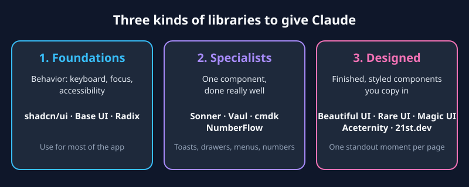
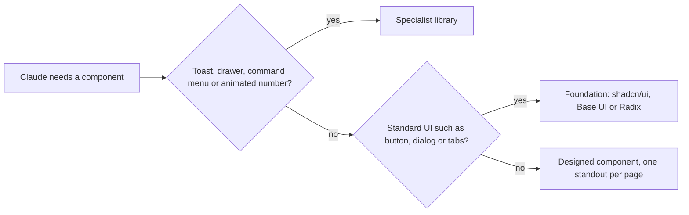

Ask an AI coding agent for a toast, a drawer or a command menu and it writes a new one, with default styling, every time. In [a 4-minute video](https://www.youtube.com/watch?v=zsCGS-Yzjnw), designer Griffin Wooldridge argues for the opposite: give Claude a library that already got those details right. Here is his argument, the libraries he names, and a few caveats.

## Hand-built components get default styling every time

Wooldridge's starting point ([0:00](https://youtu.be/zsCGS-Yzjnw?t=0)): when you ask for a toast, a command menu or a loading state, the model builds one from scratch. It doesn't know how a toast should stack or how a drawer should feel when you drag it. A component library hands it someone else's taste, and he says each kind of library does a different job.



## Foundations give you behavior, you add the look

The first kind ([0:31](https://youtu.be/zsCGS-Yzjnw?t=31)) is foundations: shadcn/ui, Base UI and Radix. They provide behavior (keyboard navigation, focus, accessibility), which is easy to get wrong by hand, and you do the styling. He uses them for most of an app: buttons, inputs, dialogs, dropdowns, tabs.

The three are close relatives. [shadcn/ui](https://ui.shadcn.com) calls itself the foundation for a design system: composable, accessible components with code you can customize and make your own. [Base UI](https://base-ui.com) is a library of unstyled React components from the creators of Radix, Floating UI and Material UI; it works with Tailwind, CSS Modules or plain CSS, and keeps its API close to Radix for easier migration. [Radix](https://www.radix-ui.com) describes itself as an open source component library optimized for fast development, easy maintenance and accessibility.

His warning ([1:02](https://youtu.be/zsCGS-Yzjnw?t=62)): default shadcn has become an AI look of its own, with the same radius, the same gray and the same fonts. Treat it as a starting point and change the radius, the colors and the type, which carry most of the personality. A tighter radius and a serif heading can make the same components feel like an editorial product instead of a SaaS template. Because shadcn copies its code into your project, Claude can change all of it, especially if you give it your brand colors and fonts up front.

## Specialists fix the details AI skips

The second kind ([1:32](https://youtu.be/zsCGS-Yzjnw?t=92)) is libraries that do one component really well:

- **Sonner** for toasts: how they stack, expand on hover and animate in and out.
- **Vaul** for drawers you drag up from the bottom on mobile and flick down to close. [Its npm page](https://npmjs.com/package/vaul) describes it as an unstyled React drawer that can replace a Dialog on tablet and mobile.
- **cmdk** for the command menu you open with Cmd+K. [The repository](https://github.com/dip/cmdk) calls it a command menu React component that can also serve as an accessible combobox: you render items, it filters and sorts them.
- **NumberFlow** so a price or a count ticks over instead of jumping. [Its docs](https://number-flow.barvian.me/) say the component transitions automatically when the `value` prop changes, and it takes standard number formatting options:

```tsx
<NumberFlow
  value={value}
  format={{ style: "currency", currency: "USD" }}
  suffix="/mo"
/>
```

You notice these when they are missing. In his telling, hand-built toasts pile on top of each other or vanish before you can read them, a hand-built drawer often won't drag at all, and a homemade command menu breaks as soon as you use the keyboard ([2:03](https://youtu.be/zsCGS-Yzjnw?t=123)).

Sonner and Vaul were both made by Emil Kowalski, who also has a skill called `pick-ui-library`. According to the video, it gives Claude a short list of libraries with one sentence on why to use each, so if Claude starts building its own toast system, it picks Sonner instead.

## Designed components add polish, if you ration them

The third kind ([2:34](https://youtu.be/zsCGS-Yzjnw?t=154)) is finished, styled components you copy into your project: Beautiful UI, Rare UI, Magic UI, Aceternity, and 21st.dev, a marketplace where many design engineers publish components.

- **Beautiful UI** is the one he'd look at first for an AI product. He says it is made by Turbo and covers states most older libraries predate: streaming text, approval cards for when an agent needs permission, diff views and agent screens. [Its site](https://www.beautifului.dev/) lists 21 primitives, including thinking traces, tool chips, task rows, a prompt bar and context cards.
- **Rare UI** is for flashy moments: animated buttons, text effects, interactive backgrounds.
- **Magic UI** is made to sit on top of shadcn. [Its site](https://magicui.design/) lists 150+ free, open-source animated components built with React, TypeScript, Tailwind CSS and Motion.
- **Aceternity** is for landing-page effects such as 3D cards and background beams. The auto-captions garble the name, so this is my reading of the context.

His rule for this group ([3:37](https://youtu.be/zsCGS-Yzjnw?t=217)): one huge standout moment per page. One animated hero or one interactive background makes a page feel designed. Ten of them is the next AI-generated look, where everything glows and moves and nothing stands out.

## Name the library, install it into the project

He gives three ways to get Claude to use all this ([3:37](https://youtu.be/zsCGS-Yzjnw?t=217)):

1. Name the libraries in the prompt, for example "use shadcn for the base components and Sonner for toasts".
2. Install through the library's CLI or registry, so the code lives in your project where Claude can read it and you can change it.
3. Install the `pick-ui-library` skill and let it choose.

My summary of the decision, not a diagram from the video:



## What I'd add

- **The video names libraries, it doesn't compare them.** The pages I read describe each library in its own favorable terms. For example, Base UI says it is more robust than Radix and maintained by a dedicated team of seven working on it full-time, which is its own claim, not an independent one.
- **Copy-in code is also code you maintain.** This is my inference, not something the sources say: when the upstream library fixes a bug, a copy that lives in your repo doesn't update by itself.
- **Specialists have limits.** NumberFlow's docs list scientific and engineering notations, non-Latin digits and right-to-left locales as unsupported, and warn that backgrounds and borders on the component won't scale smoothly during transitions.
- **Not everything was checked.** The captions are auto-generated and mangle several names. I confirmed names against the sites of shadcn/ui, Base UI, Radix, Vaul, cmdk, NumberFlow, Beautiful UI and Magic UI. For Sonner, Rare UI, Aceternity, 21st.dev and the `pick-ui-library` skill, what you read above comes only from the video.

## Takeaways

- Don't let the model hand-build toasts, drawers, command menus or animated numbers: use a specialist library.
- Use a foundation (shadcn/ui, Base UI or Radix) for the bulk of the app, then change the radius, colors and type so it doesn't look like default shadcn.
- Designed-component libraries add polish, but keep to one standout effect per page.
- Name the libraries in your prompt and install them into the project so the code is readable and editable.
- Treat the video's picks as a shortlist, not a benchmark.
