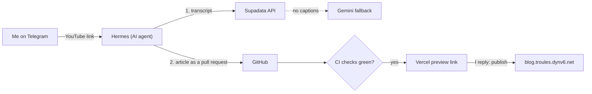

Most of the video summaries on this blog start with me pasting a YouTube link into Telegram on my phone.
A few minutes later I get a preview link to a finished article, and I publish it with a one-word reply.
This post shows the parts in between and explains why the transcript step goes through
[Supadata](https://supadata.ai).

## The whole flow in one picture

There are three steps, and I'm only involved at the first and last ones.

## Step 1: Hermes gets the transcript through Supadata

**Hermes** is my assistant. It runs on a small cloud server and I talk to it through a Telegram bot. When I send
it a video link, it first needs the words spoken in the video.

The obvious approach is to download YouTube's captions directly from the server, but that doesn't work: YouTube
blocks requests coming from cloud providers' IP addresses. Hermes therefore calls a tool I wrote (a small
[MCP](https://modelcontextprotocol.io) server, the standard way to give an AI agent new tools). The tool tries
two routes in order:

1. **Supadata** returns the video's existing captions through a simple HTTP API. They are the exact captions,
   with timestamps, so the article can link to precise moments in the video. This route handles almost every
   video.
2. **Gemini** is the fallback when a video has no captions. It listens to the video and transcribes it.

The only thing either service receives is the public video URL. Results are cached for a few hours, so if I ask
a follow-up question about the same video, no extra credit is used. A `/yt` command in Telegram shows how much
of the monthly Supadata quota is left.

## Step 2: the article arrives as a pull request

Hermes reads the transcript and pitches an outline: title, angle, sections and tags. It writes nothing until
I answer "OK" or adjust the outline. Then it writes the article as a plain Markdown file and opens a pull request
on GitHub, the same review process a developer would use for a code change.

Automated checks run on every pull request. They validate the article's format and every diagram, check that
links are safe, and make sure Hermes only touched the blog's content folder. Vercel builds a preview of the
site with the new article.

## Step 3: I review on my phone and reply "publish"

Hermes sends me one message with the preview link, the check status and the word count. I read the article as
it will appear, ask for changes in plain words if needed, and reply **publish** once I'm happy. Hermes merges
exactly the version I previewed, and the article is live about a minute later.

> [!NOTE]
> Hermes can't publish on its own initiative. It needs my explicit reply, the checks must pass, and it can't
> change the code that runs those checks.

## Why this works well

- **Fast**: I go from link to published article in about ten minutes, all on my phone.
- **Accurate**: the article is grounded in the actual transcript, with timestamps, not in what the model
  remembers about the topic.
- **Safe**: everything goes through a reviewed pull request. Nothing reaches the site without my approval.
- **Cheap**: every piece fits in a free tier, including the transcript API.

For the git and preview side of things, see [How this blog works](/how-this-blog-works).
