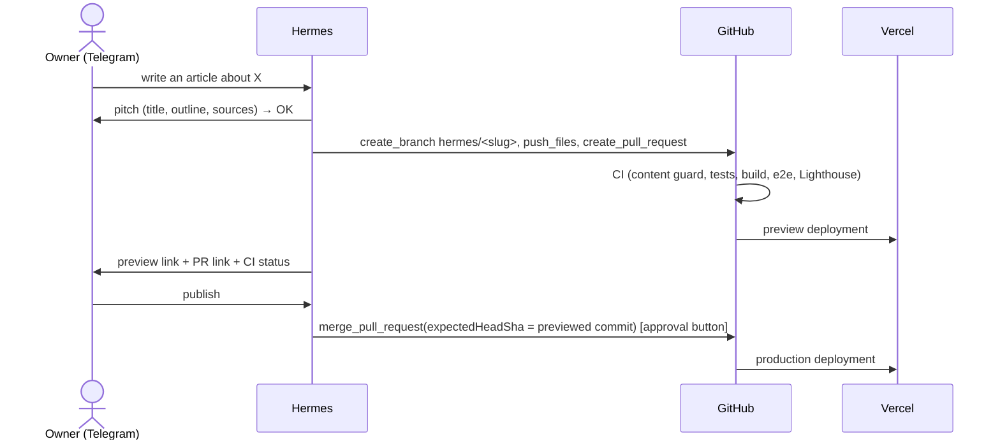

# 0004. Publishing from Telegram through pull requests

- Status: accepted
- Date: 2026-10-31

## Context

The owner wants the whole publishing process on Telegram, with a review step. Hermes talks to GitHub through GitHub's
hosted MCP server with a fine-grained token; that token acts as the owner's account (an admin), so any control must
hold even against an admin token.

## Decision

- Skill `skills/blog-article-creator` defines the flow; Hermes installs it from this repo.
- Token: fine-grained PAT, **only `troules-sites`**, permissions _Contents: read/write_, _Pull requests: read/write_
  (no _Workflows_, no _Administration_). Hermes's MCP config exposes only: `get_file_contents`, `create_branch`,
  `push_files`, `create_or_update_file`, `create_pull_request`, `update_pull_request`, `pull_request_read`,
  `merge_pull_request`; `trust: untrusted`, so every write asks the owner in Telegram.
- Ruleset on `main`: PR required, required checks, no force push/deletion, **no bypass actors**. So the token can't
  push to `main` even though its owner is an admin.
- CI `Content guard`: a `hermes/*` branch touching anything outside `apps/blog/content/` fails.
- Merge uses `expectedHeadSha`: GitHub refuses if commits were added after the owner's preview.

## Consequences

- The owner's tap on the approval button is the review; the preview is the article exactly as it will ship.
- Preview deployments are behind Vercel Authentication by default: the owner signs in to Vercel once on the phone
  (or we disable preview protection for the blog project: decision for the owner).
- Hermes could still write a misleading article; the review step is the control for content quality.
