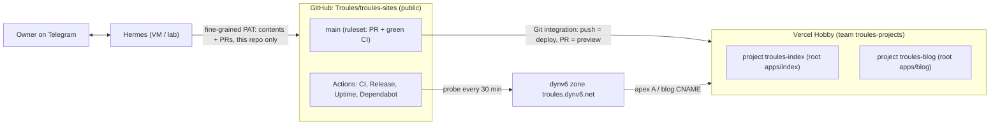

# Architecture

Status: living document. Decisions and their reasons are in [`adr/`](adr/); this page is the map.

## Pieces

| Piece                 | Choice                                                                                | ADR                                              |
| --------------------- | ------------------------------------------------------------------------------------- | ------------------------------------------------ |
| Repo                  | pnpm workspaces + Turborepo, public                                                   | [0001](adr/0001-monorepo.md)                     |
| Framework / hosting   | Next.js 16 (App Router, Cache Components, React Compiler), Vercel Hobby, static-first | [0002](adr/0002-nextjs-vercel-static-first.md)   |
| Blog content          | Markdown + front matter in git, rendered without code execution; SVG + Mermaid        | [0003](adr/0003-blog-content-markdown-in-git.md) |
| Publishing            | Hermes opens PRs; owner approves from Telegram; merge pinned to the previewed SHA     | [0004](adr/0004-publishing-from-telegram.md)     |
| Quality gates / CI/CD | lint, types, unit, e2e + axe, Lighthouse, changesets, rulesets, supply-chain controls | [0005](adr/0005-quality-gates-and-release.md)    |
| Monitoring            | Vercel Web Analytics + Speed Insights, uptime probe → issue + ntfy                    | [0006](adr/0006-monitoring.md)                   |
| Domains               | dynv6 zone `troules.dynv6.net` → Vercel                                               | [0007](adr/0007-domains-dynv6.md)                |
| Index design          | Liquid glass as progressive enhancement                                               | [0008](adr/0008-liquid-glass.md)                 |

## Limits that matter (free tiers, checked 2026-10)

| Service                      | Limit                                                                                                     | How we stay inside                                                                       |
| ---------------------------- | --------------------------------------------------------------------------------------------------------- | ---------------------------------------------------------------------------------------- |
| Vercel Hobby                 | non-commercial; 100 GB transfer, 1M function invocations, 100 deploys/day, 5k image transformations/month | static pages, proxy only on article/tag URLs, `turbo-ignore` skips unaffected app builds |
| Vercel Web Analytics (Hobby) | 50k events/month                                                                                          | one pageview event per visit, no custom events                                           |
| GitHub Actions               | unlimited minutes on public repos                                                                         | —                                                                                        |
| Scheduled workflows          | disabled after 60 days without repo activity                                                              | Dependabot PRs keep the repo active                                                      |
| dynv6                        | free, zone + records via UI/API                                                                           | 2 records                                                                                |

## Ports (local)

`dev`: index 3000, blog 3001. `start` for e2e/Lighthouse: index 3100, blog 3200.
