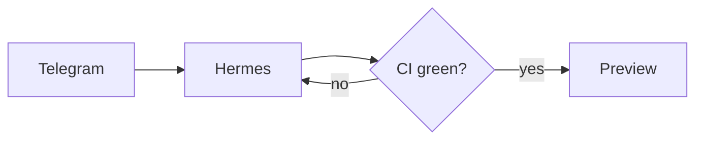

# Article format

One folder per article: `apps/blog/content/<slug>/index.md`, plus its images (`.svg`, `.png`, `.jpg`, `.webp`)
next to it. Max 1.5 MB per file. Through the GitHub tools you can only write text files, so images are **SVG**.

## Front matter (YAML, every string in double quotes)

```yaml
---
title: "Why WebGPU changes in-browser ML"
description: "One or two sentences (20–200 chars) shown in lists, feeds and link previews."
date: "2026-11-02T14:30" # now, Europe/Paris; the time only orders same-day posts
lang: "en" # "en" or "fr"
kind: "research" # "research" | "video-summary" | "note"
tags: ["webgpu", "machine-learning"]
sources: # required for research and video-summary; rendered as a numbered list at the end
  - title: "WebGPU explainer (W3C)"
    url: "https://gpuweb.github.io/gpuweb/explainer/"
video: # required for video-summary
  url: "https://www.youtube.com/watch?v=VIDEO_ID"
  title: "Exact video title"
  channel: "Channel name"
cover: # optional: used for link previews
  src: "./cover.svg"
  alt: "What the image shows"
draft: false # optional: true = visible only on preview deployments
updated: "2026-11-05" # optional: only when revising a published article
---
```

Unknown keys are rejected.

## Body: GitHub-flavoured Markdown

- Headings `##` and `###` only (the title is rendered as the h1).
- Paragraphs, **bold**, _italic_, lists, task lists, tables, footnotes `[^1]`, `inline code`, fenced code with a language
  (` ```ts `), links `[text](https://…)`.
- Callouts:
  ```md
  > [!NOTE]
  > Useful aside.
  ```
  Also `[!TIP]`, `[!IMPORTANT]`, `[!WARNING]`, `[!CAUTION]`.
- Images: ``.
- Citations: link the claim itself, `according to [Exo's README](https://github.com/exoharness/exo), …`.
  Not `[1]` (renders as plain text), not a "Sources" section (already rendered from front matter). Footnotes `[^1]`
  are for asides, not citations.
- YouTube timestamps for video summaries: `[12:34](https://youtu.be/VIDEO_ID?t=754)`.

Raw HTML is stripped. There is no MDX, JSX, embed or iframe.

## Mermaid diagrams

````md

````

Supported: `flowchart`, `sequenceDiagram`, `timeline`, `mindmap`, `stateDiagram-v2`, `classDiagram`, `erDiagram`,
`pie`, `quadrantChart`, `gantt`. Keep under ~15 nodes; quote labels with punctuation; no `click` or HTML labels
(stripped by `securityLevel: strict`). CI parses every diagram.

## SVG illustrations

Hand-written, simple, and readable on both light and dark backgrounds (give it its own background rect).
Include `viewBox`, `width`, `height`, and a `<title>`. Use system fonts. No scripts, `<foreignObject>`, event
attributes, external images or fonts.
